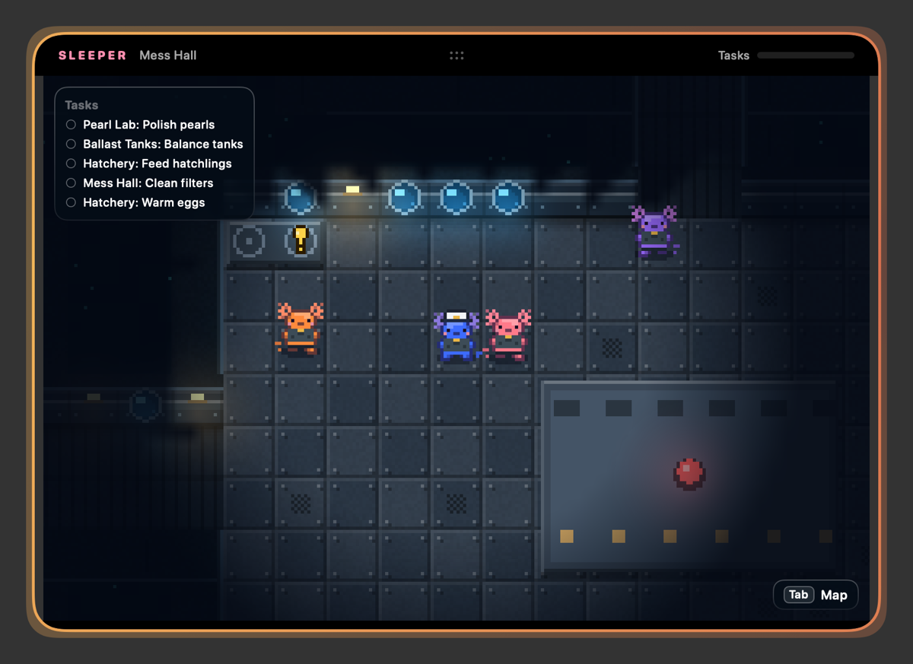
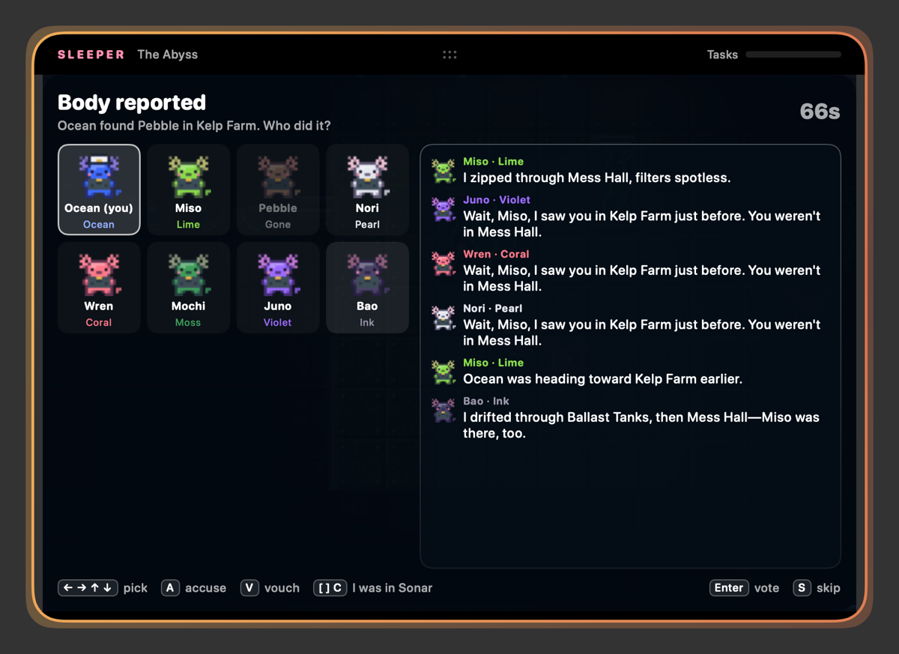

# Sleeper

A social deduction game that lives in the MacBook notch. Eight axolotls run **The Abyss**, a cluster of domes on the deep
ocean floor joined by glass tunnels. One of them is a traitor. Everything is painted in a storybook style: ink lines and
watercolour.



## Requirements

- macOS 26 or later, on a Mac with or without a notch (without one, the island hangs from the top centre of the screen).
- Swift 6.2 or later (Xcode 26 or later) to build.
- Optional: Apple Intelligence turned on, for the AI crew's on-device voices (see [The AI crew](#the-ai-crew)).

## Run it

```sh
scripts/build-app.sh            # builds .build/app/Sleeper.app (release, ad-hoc signed)
open .build/app/Sleeper.app
```

Or straight from source: `swift run Sleeper`.

## The island

Sleeper opens as an island hanging from the notch. A bubbles icon in the menu bar has the same controls.

| Do this | What happens |
| --- | --- |
| **Esc** | Folds the island into the notch: a slim strip with your axolotl on the left and task progress, the oxygen countdown or "Meeting" on the right. The game pauses and the keyboard goes back to the app you were using. |
| **⌃⌥S**, or click the folded strip | Opens the island again. |
| Drag the black header | Moves the island anywhere. Let go near the top centre (the outline turns pink) and it docks into the notch; let go anywhere else and it floats as a card. |
| Double-click the header | Docks it, or floats it at the top centre if it's already docked. |

The game also pauses whenever you click into another app.

## How to play

You and seven AI crew. Your role is random; change it in the lobby with **R**. In the lobby, **← →** picks your colour
and **↑ ↓** your hat.

| Key | Action |
| --- | --- |
| WASD / arrows | Swim |
| E or Space | Use: a task, the emergency button at the Mess Hall table, a sabotage fix |
| R | Report a body you're standing near |
| Q | Take out a crewmate (traitor only, cooldown 25 s) |
| 1 / 2 | Sabotage the lights / the oxygen (traitor only) |
| Tab or M | Map of the station with your tasks |
| Esc | Close a task, or fold the island into the notch |

**The crew** win by finishing every task or voting out the traitor. Tasks are small mini-games: hold E to fill a gauge,
press arrows in order, or stop a needle in the green three times. Yellow `!` tags mark your task stations.

**The traitor** wins when the crew can no longer outnumber them, or when an oxygen leak runs out. Lights-out shrinks
everyone's sight until someone fixes the panel in Thermal Vent. The oxygen leak needs both consoles sealed, in Pressure
Lock and Ballast Tanks, within 45 seconds.

You only see what your axolotl can see. Dome hulls block sight, but tunnel glass doesn't, so you can watch the sea and
the other tunnels as you swim between domes. Dead crew become ghosts: they can still finish tasks but can't speak or
vote.

### Meetings

A reported body or the emergency button calls everyone to the table. The AI crew say where they were and who they saw.
They vouch for each other and call out anyone whose story doesn't match what they saw. The traitor lies about being near
the body. Then everyone votes.

| Key | In a meeting |
| --- | --- |
| T | Type a message; Enter sends, Esc closes. Name a player or a colour to accuse or clear them ("Miso is lying", "lime was with me"), or give an alibi ("I was in Kelp Farm"). Whoever you accuse answers back. |
| Arrows | Pick a player |
| A / V | Accuse / vouch for the picked player |
| [ ] then C | Choose a room, then say "I was in …" |
| Enter | Vote for the picked player |
| S | Skip your vote |



## The AI crew

The crew's behaviour and words are rule-based, so the game works the same everywhere. Each AI remembers who it saw, where
and when. It suspects whoever was near a body, whoever it caught lying about where they were, and whoever others accuse.
The traitor kills only when no one is watching, sabotages now and then, sometimes reports its own kill, and lies about
where it was when it has to.

Where the words come from:

- `Sources/SleeperCore/AI.swift`, `compose()`: each crew member's meeting lines (alibis, vouching, accusations, and the
  traitor's lies).
- `AI.swift`, `hear()`: the "Wait, X, I saw you in …" call-out when an alibi doesn't match a sighting.
- `AI.swift`, `understand()` and `reply(to:)`: how the crew read your typed messages, and how the accused answer.
- `Sources/SleeperApp/AIVoice.swift`: the only prompt for a language model. When Apple's on-device model is available,
  it restyles alibis and body reports in each crew member's own voice (personalities are listed in the same file).
  Accusations never go through it, and any rewrite that drops a name is thrown away. Without the model, the built-in
  lines are used.

## How it's built

- `Sources/SleeperCore`: the game, with no UI. The dome map, A* pathfinding, line of sight, the rules, the AI crew and
  traitor, and meetings. It runs on a fixed 30 Hz step with a seeded random generator, so a network layer can drive it
  later.
- `Sources/SleeperApp`: the island (built on [NotchKit](https://github.com/neelrocketbots/notchkit)), the SpriteKit
  scene and the SwiftUI screens.
  - The axolotl, the hats and the props are generated storybook art, cut out and stored in `Sources/SleeperApp/Assets`.
    There is one grey axolotl, recoloured in code for the 12 player colours; its vest and buckle keep their colours.
  - Domes, glass tunnels and the sea are drawn in code when a game starts, from three painted textures in the same
    folder (floor, wall and tunnel grating).
  - It's 2.5D: walls, props and the crew are sorted by where they stand, so axolotls walk behind tanks and behind the
    front of each dome's hull.
  - A line-of-sight fog is redrawn 30 times a second.
- `docs/SPEC.md`: the decisions made while designing the game. `docs/style-compare/`: the four art styles that were
  tried before storybook was chosen.

### Changing the art

The sprites were cut from generated sheets: each sheet shows several objects in a row on a plain white background. To
replace them, put new sheets in a folder under the same names (`axolotl.png`, `hats.png`, `props-a.png` to `props-d.png`,
`table2.png`, `floor.png`, `corridor.png`, `wall.png`) and run:

```sh
.build/debug/Sleeper --cut-assets <folder> Sources/SleeperApp/Assets
```

It removes the white background, splits each sheet at the gaps, trims and resizes each piece. The names it gives each
piece are listed in `Sources/SleeperApp/Debug/AssetCutter.swift`.

## Checks

```sh
swift test                                   # rules, map, chat, AI games played to the end, balance, honest alibis
.build/debug/Sleeper --selftest              # plays through the real key path and prints PASS/FAIL
.build/debug/Sleeper --snapshots /tmp/snaps  # plays a scripted game and saves each screen as a PNG
SLEEPER_DOCK_DEBUG=1 .build/debug/Sleeper    # prints where docking and floating put the island, then quits
```

The snapshots are drawn offscreen, so they work without screen-recording permission or with the display asleep.

With the human idle, AI-only games split roughly evenly between crew and traitor wins, and a round lasts about 4 to 5
minutes.

## Not yet

LAN and online multiplayer, vents, sound, more than one traitor, and cosmetics beyond hats.
